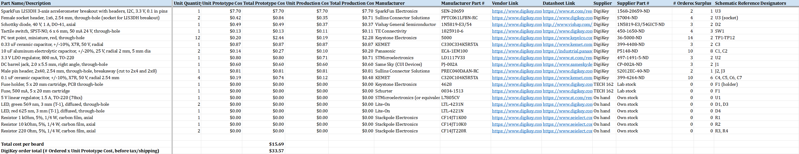

## Overview

This Bill of Materials covers every component on my slip-detection subsystem schematic: the LIS3DH accelerometer breakout (I2C), power regulation, debug LEDs and push button, test points, and the Curiosity Nano interface headers. Parts are grouped by supplier:

* **DigiKey**: parts being ordered. Quantities follow the class rule of one for the breadboard, one for the PCB, and 1-2 spares, rounded up to a price break where that was cheaper.
* **TECH 162**: parts taken from the lab inventory (not ordered).
* **On hand**: parts I already own (not ordered).

All parts are through-hole. The accelerometer is a SparkFun LIS3DH breakout with 0.1 in headers (approved by the instructor), which plugs directly into the PCB. The Curiosity Nano board is not included because it is supplied separately.

## Bill of Materials

**Figure 1:** Bill of Materials spreadsheet.

*Table 1: Bill of Materials for the slip-detection subsystem.*

Click to expand the full BOM table

| **Part Name/Description** | **Qty (per board)** | **Qty Ordered** | **Unit Cost** | **Total Cost** | **Manufacturer** | **Manufacturer #** | **Supplier** | **Supplier #** | **Vendor Link** | **Datasheet Link** | **Schematic Reference Designators** |
|:---|:---|:---|:---|:---|:---|:---|:---|:---|:---|:---|:---|
| SparkFun LIS3DH 3-axis accelerometer breakout with headers, I2C, 3.3 V, 0.1 in pins | 1 | 2 | $7.70 | $15.40 | SparkFun Electronics | SEN-20659 | DigiKey | 1568-20659-ND | [DigiKey](https://www.digikey.com/en/products/detail/sparkfun-electronics/20659/21703932) | [Datasheet](https://www.st.com/resource/en/datasheet/lis3dh.pdf) | U3 |
| Female socket header, 1x6, 2.54 mm, through-hole (socket for LIS3DH breakout) | 2 | 4 | $0.42 | $1.68 | Sullins Connector Solutions | PPTC061LFBN-RC | DigiKey | S7004-ND | [DigiKey](https://www.digikey.com/en/products/detail/sullins-connector-solutions/PPTC061LFBN-RC/810145) | [Datasheet](https://www.digikey.com/en/products/detail/sullins-connector-solutions/PPTC061LFBN-RC/810145) | U3 (socket) |
| Schottky diode, 40 V, 1 A, DO-41, axial | 1 | 3 | $0.49 | $1.47 | Vishay General Semiconductor | 1N5819-E3/54 | DigiKey | 1N5819-E3/54GICT-ND | [DigiKey](https://www.digikey.com/en/products/detail/vishay-general-semiconductor-diodes-division/1N5819-E3-54/1023527) | [Datasheet](http://www.vishay.com/docs/88525/1n5817.pdf) | D2 |
| Tactile switch, SPST-NO, 6 x 6 mm, 50 mA 24 V, through-hole | 1 | 4 | $0.13 | $0.52 | TE Connectivity | 1825910-6 | DigiKey | 450-1650-ND | [DigiKey](https://www.digikey.com/en/products/detail/te-connectivity-alcoswitch-switches/1825910-6/1632536) | [Datasheet](https://www.digikey.com/en/products/detail/te-connectivity-alcoswitch-switches/1825910-6/1632536) | SW1 |
| PC test point, miniature, red, through-hole | 12 | 14 | $0.203 | $2.842 | Keystone Electronics | 5000 | DigiKey | 36-5000-ND | [DigiKey](https://www.digikey.com/en/products/detail/keystone-electronics/5000/255326) | [Datasheet](https://www.keyelco.com/userAssets/file/M65p84.pdf) | TP1-TP12 |
| 0.33 uF ceramic capacitor, +/-10%, X7R, 50 V, radial | 1 | 3 | $0.87 | $2.61 | KEMET | C330C334K5R5TA | DigiKey | 399-4408-ND | [DigiKey](https://www.digikey.com/en/products/result?keywords=C330C334K5R5TA) | [Datasheet](https://www.kemet.com/content/dam/kemet/lightning/documents/ec-content/KEM_C1002_X7R_GOLDMAX.pdf) | C3 |
| 10 uF aluminum electrolytic capacitor, +/-20%, 25 V, radial 2 mm, 5 mm dia | 2 | 10 | $0.137 | $1.37 | Panasonic | ECA-1EM100 | DigiKey | P5148-ND | [DigiKey](https://www.digikey.com/en/products/detail/panasonic-electronic-components/ECA-1EM100/245007) | [Datasheet](https://industrial.panasonic.com/cdbs/www-data/pdf/RDF0000/ABA0000C1209.pdf) | C1, C2 |
| 3.3 V LDO regulator, 800 mA, TO-220 | 1 | 3 | $0.80 | $2.40 | STMicroelectronics | LD1117V33 | DigiKey | 497-1491-5-ND | [DigiKey](https://www.digikey.com/en/products/detail/stmicroelectronics/LD1117V33/586012) | [Datasheet](https://www.st.com/resource/en/datasheet/ld1117.pdf) | U2 |
| DC barrel jack, 2.0 x 5.5 mm, right angle, through-hole | 1 | 3 | $0.60 | $1.80 | Same Sky (CUI Devices) | PJ-002A | DigiKey | CP-002A-ND | [DigiKey](https://www.digikey.com/en/products/detail/same-sky-formerly-cui-devices/PJ-002A/96962) | [Datasheet](https://www.sameskydevices.com/product/resource/pj-002a.pdf) | J1 |
| Male pin header, 2x40, 2.54 mm, through-hole, breakaway (cut to 2x4 and 2x8) | 1 | 2 | $0.81 | $1.62 | Sullins Connector Solutions | PREC040DAAN-RC | DigiKey | S2012EC-40-ND | [DigiKey](https://www.digikey.com/en/products/detail/sullins-connector-solutions/PREC040DAAN-RC/2774854) | [Datasheet](https://www.digikey.com/en/products/detail/sullins-connector-solutions/PREC040DAAN-RC/2774854) | J2, J3 |
| 0.1 uF ceramic capacitor, +/-10%, X7R, 50 V, radial 2.54 mm | 4 | 10 | $0.186 | $1.86 | KEMET | C320C104K5R5TA | DigiKey | 399-4264-ND | [DigiKey](https://www.digikey.com/en/products/detail/kemet/C320C104K5R5TA/818040) | [Datasheet](https://www.kemet.com/content/dam/kemet/lightning/documents/ec-content/KEM_C1002_X7R_GOLDMAX.pdf) | C4, C5, C6, C7 |
| Fuse holder, 5 x 20 mm cartridge, PCB through-hole | 1 | 0 | $0.00 | $0.00 | Keystone Electronics | 4628 | TECH 162 | Lab stock | [DigiKey](https://www.digikey.com/en/products/detail/keystone-electronics/4628/2137316) | [Datasheet](https://www.digikey.com/en/products/detail/keystone-electronics/4628/2137316) | F1 (holder) |
| Fuse, 500 mA, 5 x 20 mm cartridge | 1 | 0 | $0.00 | $0.00 | Schurter | 0034-1513 | TECH 162 | Lab stock | [DigiKey](https://www.digikey.com/en/products/detail/schurter-inc/0034-1513/639666) | [Datasheet](https://www.digikey.com/en/products/detail/schurter-inc/0034-1513/639666) | F1 |
| 5 V linear regulator, 1.5 A, TO-220 (78xx) | 1 | 0 | $0.00 | $0.00 | STMicroelectronics (or equivalent) | L7805CV | On hand | Own stock | [DigiKey](https://www.digikey.com/en/products/detail/stmicroelectronics/L7805CV/585964) | [Datasheet](https://www.st.com/resource/en/datasheet/l78.pdf) | U1 |
| LED, green 569 nm, 3 mm (T-1), diffused, through-hole | 2 | 0 | $0.00 | $0.00 | Lite-On | LTL-4231N | On hand | Own stock | [DigiKey](https://www.digikey.com/en/products/detail/lite-on-inc/LTL-4231N/214440) | [Datasheet](https://www.digikey.com/en/products/detail/lite-on-inc/LTL-4231N/214440) | D1, D3 |
| LED, red 625 nm, 3 mm (T-1), diffused, through-hole | 1 | 0 | $0.00 | $0.00 | Lite-On | LTL-4221N | On hand | Own stock | [DigiKey](https://www.digikey.com/en/products/detail/lite-on-inc/LTL-4221N/214530) | [Datasheet](https://www.digikey.com/en/products/detail/lite-on-inc/LTL-4221N/214530) | D4 |
| Resistor 1 kOhm, 5%, 1/4 W, carbon film, axial | 1 | 0 | $0.00 | $0.00 | Stackpole Electronics | CF14JT1K00 | On hand | Own stock | [DigiKey](https://www.digikey.com/en/products/detail/stackpole-electronics-inc/CF14JT1K00/1830350) | [Datasheet](https://www.seielect.com/catalog/sei-cf_cfm.pdf) | R1 |
| Resistor 10 kOhm, 5%, 1/4 W, carbon film, axial | 1 | 0 | $0.00 | $0.00 | Stackpole Electronics | CF14JT10K0 | On hand | Own stock | [DigiKey](https://www.digikey.com/en/products/result?keywords=CF14JT10K0) | [Datasheet](https://www.seielect.com/catalog/sei-cf_cfm.pdf) | R2 |
| Resistor 220 Ohm, 5%, 1/4 W, carbon film, axial | 2 | 0 | $0.00 | $0.00 | Stackpole Electronics | CF14JT220R | On hand | Own stock | [DigiKey](https://www.digikey.com/en/products/result?keywords=CF14JT220R) | [Datasheet](https://www.seielect.com/catalog/sei-cf_cfm.pdf) | R3, R4 |

**DigiKey order total (before tax and shipping): $33.57**

*Total Cost = Qty Ordered x Unit Cost. TECH 162 and on-hand parts are listed at $0.00 because they are not purchased.*

Prices were taken from DigiKey on 11/12/2026 at the quantity tier being ordered.

The spreadsheet version is available [here](ak_bom_304.xlsx).