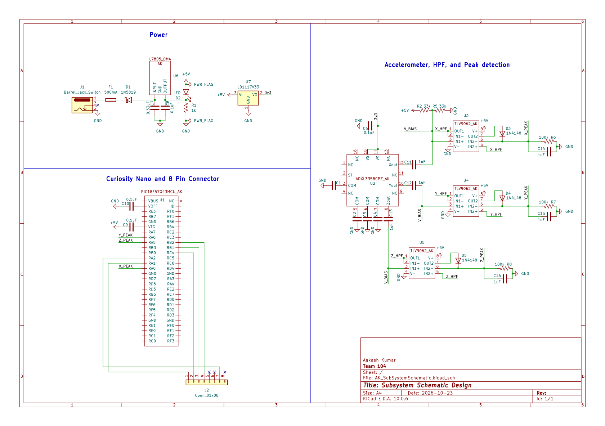

## Overview

This schematic supports a 3-axis accelerometer subsystem utilizing an ADXL335 sensor with TLV9062 op-amps for high-pass filtering and peak detection. The power management section regulates a barrel jack input down to 5V and 3.3V using L7805 and LD1117V33 regulators. System logic and data handling are managed by a PIC18F57Q43 microcontroller on a Curiosity Nano board. 

{style width:"350" height:"300;"}
**Figure 1:** Board 5 of Team 104's smart gripper.

## Resouces

The schematic as a PDF download is available [*here*](IndivSubsystemSchematic.pdf), and the Zip folder of the project [*here*](AK_SubSystemSchematic.zip).