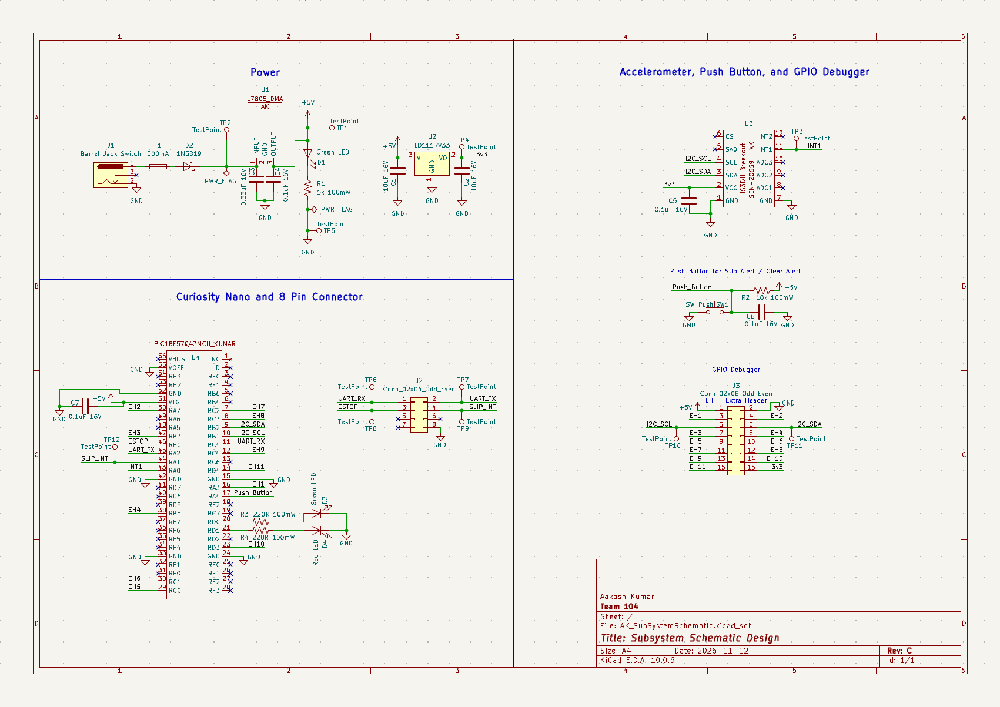

## Overview

This schematic supports a 3-axis accelerometer subsystem built around a SparkFun LIS3DH breakout board, which plugs into two 1x6 female headers and communicates with the microcontroller over I2C. The power management section regulates a 9V barrel jack input down to 5V and 3.3V using L7805 and LD1117V33 regulators, with the 3.3V rail powering the accelerometer. System logic and data handling are managed by a PIC18F57Q43 microcontroller on a Curiosity Nano board, which connects to the main hub (Board 1) through a 2x4 interboard connector carrying UART, ESTOP, and the slip alert signal. The board also includes a 2x8 extra header for spare GPIO, debug LEDs, a push button, and test points on key signals.

{style width:"350" height:"300;"}
**Figure 1:** Board 5 of Team 104's smart gripper.

## Resources

The schematic as a PDF download is available [*here*](IndivSubsystemSchematic.pdf), and the Zip folder of the project [*here*](AK_SSS_RevC.zip).