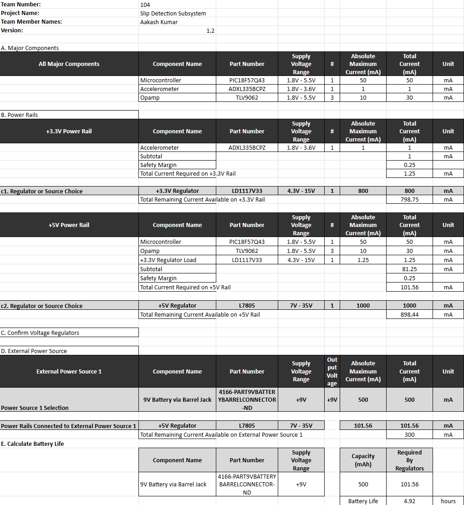

## Overview
The power budget for the Slip Detection Subsystem was created to verify that the power supply and regulators can support the chosen compnents in the circuit. It ensures that the L7805 5V and LD1117V33 3.3V regulators can safely power the Curiosity Nano, ADXL335BCPZ accelerometer, and TLV9062 operational amplifiers without exceeding their maximum ratings.

{style width:"350" height:"300;"}

## Conclusions

The system safely operates within its limits. 
 The total current draw on the 9V battery is 101.56 mA.
 The max estimated battery life of the 9V battery is 4.92 hours.
 Both voltage regulators have a significant overhead.

## Resouces

The power budget as a PDF download is available [*here*](ak_powerbudget.pdf), and a Microsoft Excel Sheet [*here*](ak_powerbudget.xlsx).
