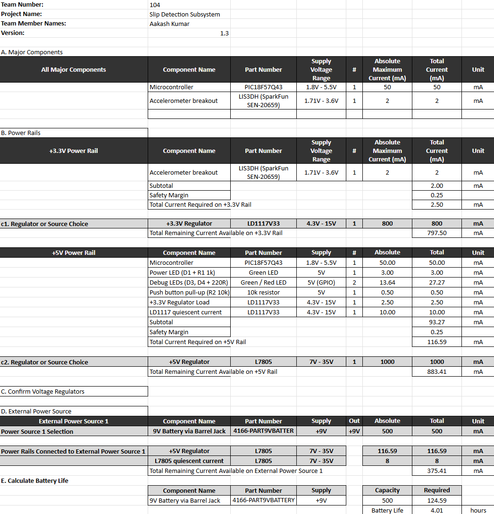

## Overview
The power budget for the Slip Detection Subsystem was created to verify that the power supply and regulators can support the chosen components in the circuit. It ensures that the L7805 5V and LD1117V33 3.3V regulators can safely power the Curiosity Nano, SparkFun LIS3DH accelerometer breakout, LEDs, and push button without exceeding their maximum ratings. The budget includes a 25% safety margin on each rail and accounts for the idle (quiescent) current drawn by both regulators.

{style width:"350" height:"300;"}

## Conclusions

The system safely operates within its limits. 
 The total current draw on the 9V battery is 124.59 mA, leaving 375.41 mA of headroom.
 The 3.3V rail requires only 2.50 mA, leaving 797.50 mA available on the LD1117V33.
 The 5V rail requires 116.59 mA, leaving 883.41 mA available on the L7805.
 The estimated worst-case battery life of the 9V battery is 4.01 hours, assuming the microcontroller draws its full 50 mA and both debug LEDs are always on.

## Resources

The power budget as a PDF download is available [*here*](ak_powerbudget.pdf), and a Microsoft Excel Sheet [*here*](ak_pb_304.xlsx).